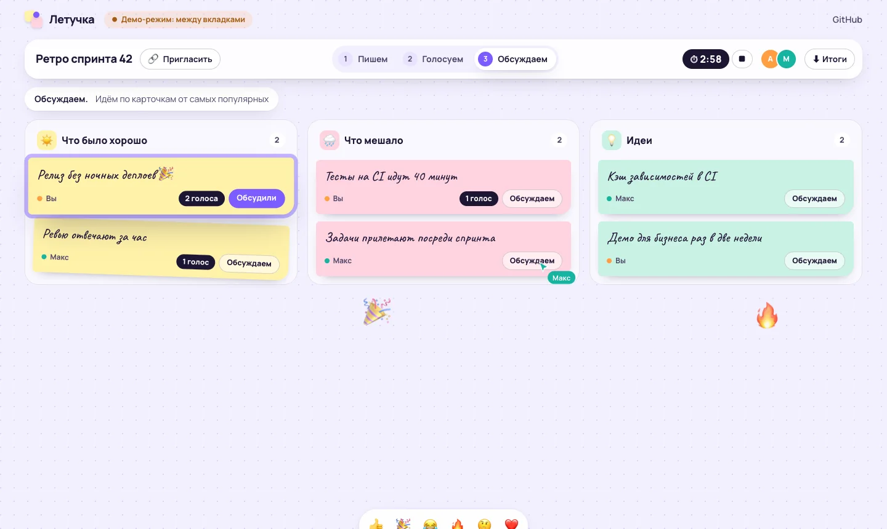
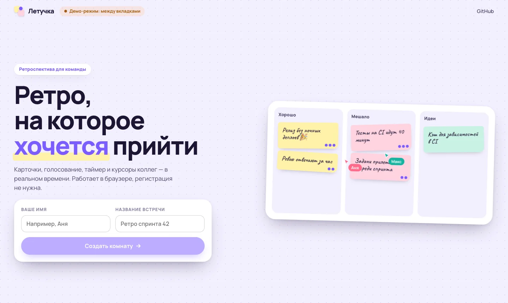
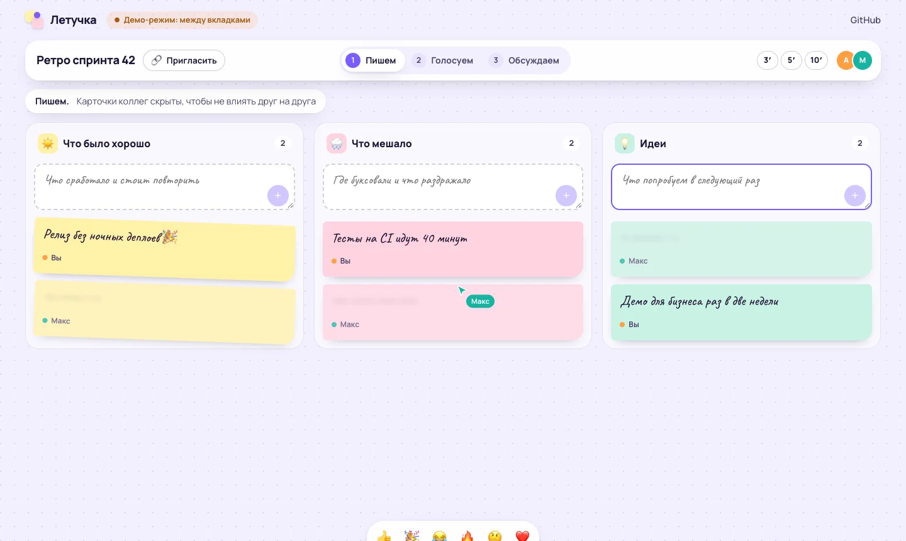
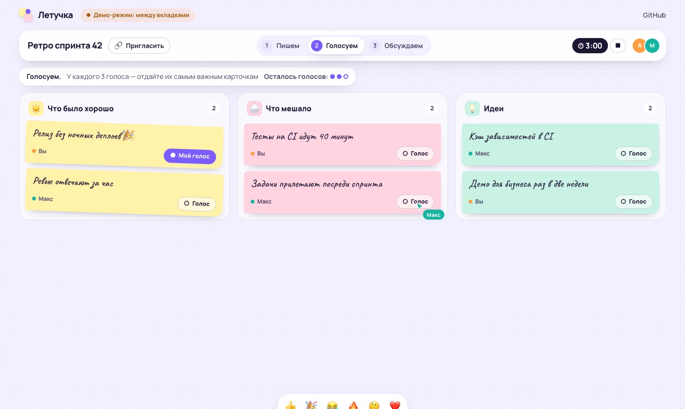
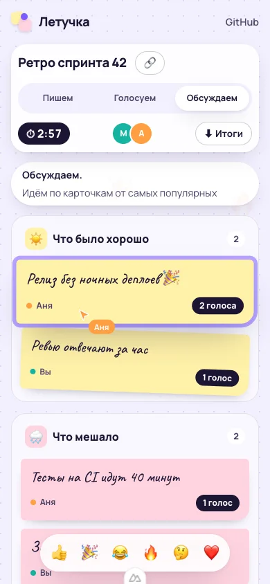

<div align="center">

<a href="https://dmitriy9427.github.io/letuchka/"></a>

# 🗂 Летучка

**Онлайн-ретроспектива для команды в реальном времени — пет-проект на Nuxt, Vue и Supabase**

### [Открыть демо →](https://dmitriy9427.github.io/letuchka/)

      [](https://github.com/dmitriy9427/letuchka/actions/workflows/pages.yml)

</div>

| Главная | Пишем: чужие карточки скрыты | Голосуем |
| --- | --- | --- |
|  |  |  |

## Коротко

| | |
| :---: | --- |
| 🔗 | **Без регистрации** — имя, ссылка команде, и все в комнате |
| ✍️ | **Три этапа** — пишем вслепую → голосуем (3 голоса) → обсуждаем от самых важных |
| 🖱 | **Реальное время** — карточки, голоса, курсоры коллег, таймер, реакции, участники онлайн |
| 🔒 | **Права в базе** — Row Level Security: этапы, авторство и лимит голосов проверяет Postgres |
| 🧩 | **Работает без сервера** — демо-режим между вкладками браузера, если ключей Supabase нет |
| 📚 | **Учебник по Vue и Nuxt для React-разработчика** — в [docs/](docs/README.md) |

Автор — [Дмитрий Рябов](https://dmitriy9427.github.io/resume/), frontend-разработчик.

---

## Как попробовать

Откройте [демо](https://dmitriy9427.github.io/letuchka/), создайте комнату и откройте её ссылку
во второй вкладке (или на телефоне — когда подключён Supabase) — это второй участник. Ведущий
(создатель комнаты) переключает этапы, ставит таймер и выделяет карточку для обсуждения.
В конце — «Итоги» копируют результаты в Markdown.

| Телефон |
| --- |
|  |

## Как устроено

Подробно и с объяснениями — в [docs/](docs/README.md):
[Vue для React-разработчика](docs/01-vue-for-react.md) ·
[Nuxt](docs/02-nuxt.md) ·
[Pinia](docs/03-pinia.md) ·
[бэкенд через интерфейс](docs/04-backend.md) ·
[Supabase: RLS и realtime](docs/05-supabase.md) ·
[курсоры и таймер](docs/06-realtime-ux.md) ·
[деплой](docs/07-deploy.md) ·
[шпаргалка к собеседованию](docs/interview.md).

```
app/
  pages/          index.vue (главная), r/[id].vue (комната)
  components/     доска, колонки, стикеры, таймер, курсоры, реакции
  stores/         Pinia: сессия, комната, уведомления
  lib/            логика доски и два бэкенда: локальный и Supabase (с тестами)
supabase/schema.sql   таблицы и правила доступа
```

## Запуск

```bash
npm install
npm run dev      # http://localhost:3110 — демо-режим между вкладками
npm run check    # линтер, типы, тесты, сборка
```

С настоящим сервером: создайте проект Supabase, выполните `supabase/schema.sql`, включите
анонимный вход и положите URL и publishable-ключ в `.env` (образец — `.env.example`).
Пошагово — [docs/05-supabase.md](docs/05-supabase.md).
