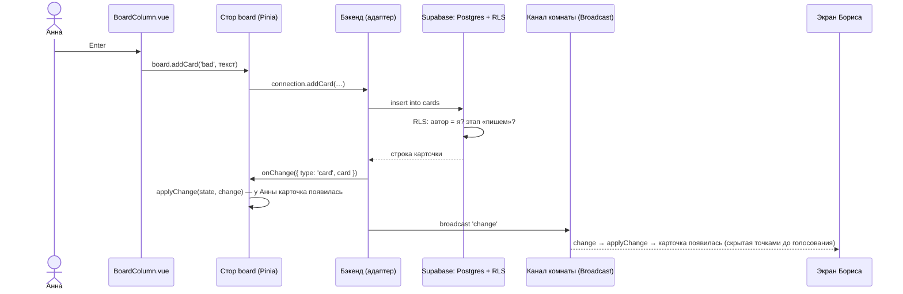

# 00. С чего начать

Этот учебник для человека, который знает **React** и хочет освоить **Vue 3**, **Nuxt** и бэкенд на
**Supabase** на живом проекте — онлайн-ретроспективе, где команда одновременно пишет карточки,
голосует и обсуждает.

## Как устроена каждая глава

1. **Зачем** — что видит человек и какую задачу решаем.
2. **Как это выглядит** — маленький пример, часто «как в React → как во Vue».
3. **Как это сделано в «Летучке»** — настоящий код с разбором.
4. **Ошибки** — что ломается у всех в первый раз.
5. **Попробуйте сами** — задания с ответами под спойлером.

Без ключей Supabase проект работает **в локальном режиме**: откройте комнату в двух вкладках — это
два участника, всё синхронизируется между вкладками.

## Картинка целиком: путь одной карточки

Анна пишет «Долгие код-ревью» в колонку «Что мешало» и жмёт Enter:

Три идеи проекта:

1. **Одна функция меняет данные — `applyChange`.** И свои действия, и действия коллег проходят
   через неё. Экраны не расходятся.
2. **Бэкенд — за интерфейсом (адаптер).** Стор зовёт `connection.addCard(...)` и не знает, кто
   отвечает: `localStorage` + `BroadcastChannel` или Supabase.
3. **Правила — в базе.** «Голосовать можно только на этапе голосования и не больше трёх раз»
   проверяет Postgres (RLS), а не только кнопка.

## Словарь в одну строку

| Слово | Простыми словами | Как в React |
| --- | --- | --- |
| **SFC** | Файл `.vue`: `<script setup>`, `<template>`, `<style scoped>` | компонент + CSS-модуль |
| **`ref`** | Реактивное значение; в скрипте — `.value`, в шаблоне — без | `useState` |
| **`computed`** | Значение, пересчитываемое при изменении того, от чего зависит | `useMemo` без списка зависимостей |
| **`watch`** | «Когда это изменится — сделай» | `useEffect` с зависимостями |
| **Директивы** | `v-if`, `v-for`, `v-model`, `:attr`, `@event` в шаблоне | JSX-выражения |
| **`v-model`** | Двусторонняя связь поля и значения | `value` + `onChange` |
| **`defineProps` / `emit`** | Пропсы и события компонента | пропсы и колбэки |
| **Слот** | Место для содержимого из родителя | `children` |
| **`nextTick`** | Дождаться, пока Vue обновит DOM | эффект после рендера |
| **Nuxt** | Фреймворк над Vue: маршруты из файлов, авто-импорты, сборка | Next.js |
| **Авто-импорт** | `useBoard()` без `import` — Nuxt подставит сам | — |
| **Pinia** | Хранилище состояния для Vue | Zustand / Redux |
| **Setup-стор** | Стор, описанный как функция с `ref` и `computed` | хук-хранилище |
| **Адаптер** | Один интерфейс — разные реализации | — |
| **BroadcastChannel** | Сообщения между вкладками одного сайта | — |
| **Supabase** | Postgres + вход + реальное время как сервис | Firebase |
| **RLS** | Правила доступа на уровне строк базы | проверки в API |
| **Анонимный вход** | Вход без почты и пароля, только с именем | — |
| **Broadcast** | Быстрые сообщения участникам канала (мимо базы) | WebSocket-рассылка |
| **Presence** | «Кто сейчас в комнате» | — |

## Как читать код проекта

- **Комментарий в начале каждого файла** — «зачем» и «почему так».
- **Чистая логика** — `app/lib/board.ts`: без Vue и без сети, с тестами.
- **Ищите по тексту на экране:** «Голоса закончились» → `app/stores/board.ts`.

## Порядок чтения

| Если вы хотите… | Читайте |
| --- | --- |
| перевести React-привычки во Vue | [01. Vue для тех, кто знает React](01-vue-for-react.md) |
| понять Nuxt | [02](02-nuxt.md) |
| хранилище | [03. Pinia](03-pinia.md) |
| бэкенд за интерфейсом | [04](04-backend.md), [05. Supabase](05-supabase.md) |
| курсоры, таймер, реакции | [06](06-realtime-ux.md) |
| понять конкретный файл | [Разбор кода](code/README.md) |
